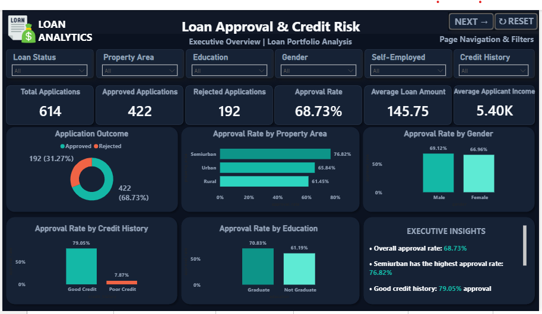
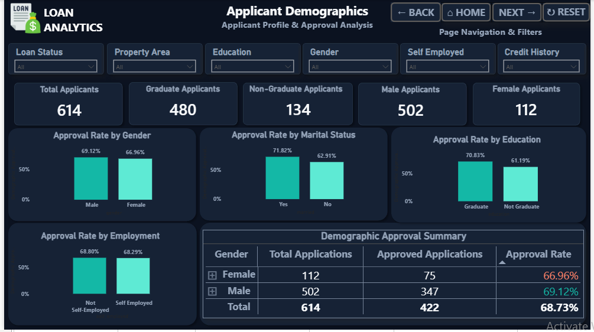
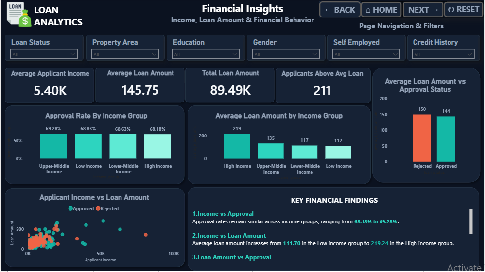
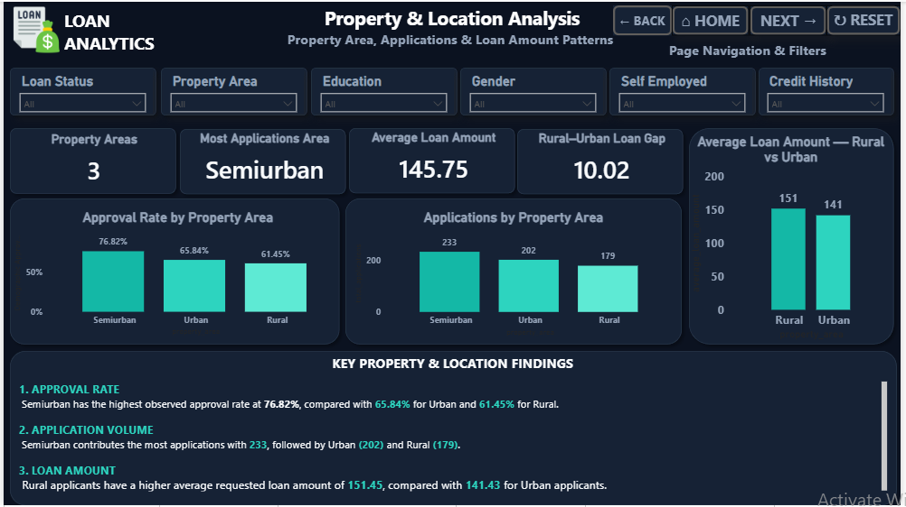
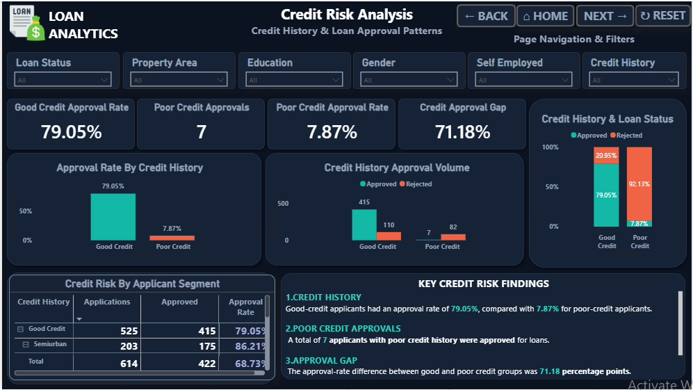
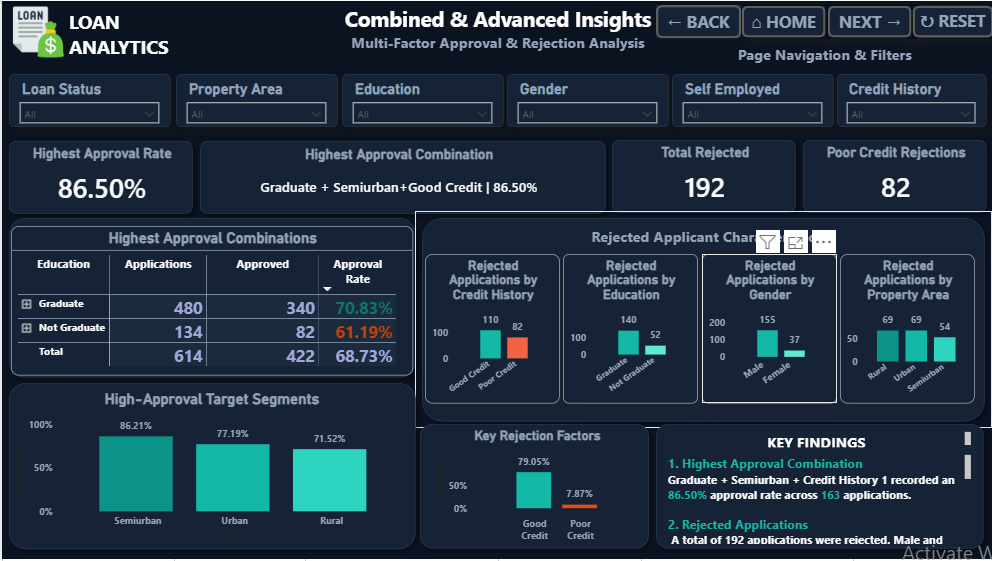
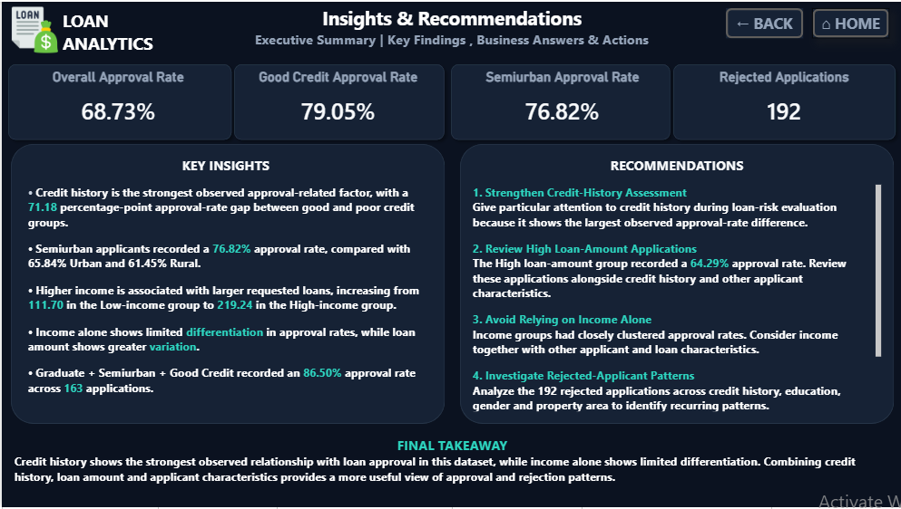

# Loan Approval Analysis

**Python • SQL • Power BI**

An end-to-end analysis of 614 loan applications to understand what separates approved applications from rejected ones. I cleaned and explored the data in Python, answered business questions in SQL, and built a 7-page Power BI dashboard.

## Business Problem

A lender wants to know **which applicant characteristics are linked to loan approval**, so it can understand why applications are rejected and where its approval process can be made clearer and more consistent.

## Key Findings

- **Overall approval rate is 68.73%.** 422 of 614 applications were approved and 192 were rejected.
- **Credit history is the strongest factor by far.** Applicants with a good credit history were approved **79.05%** of the time, against **7.87%** for applicants with a poor credit history. Only 7 of 89 poor-credit applicants were approved.
- **Poor credit explains a large share of rejections.** 82 of the 192 rejected applications (about 43%) had a poor credit history.
- **Semiurban applications do best.** Approval is 76.82% in Semiurban areas, against 65.84% in Urban and 61.45% in Rural areas.
- **Education and marital status show moderate gaps.** Graduates were approved 70.83% of the time, versus 61.19% for non-graduates. Married applicants were at 71.82%, against 62.91% for unmarried applicants.
- **The best combination is Graduate + Semiurban + good credit,** with an approval rate of 86.50% (163 applicants).
- **Income alone does not separate approvals.** Approval rates are about 68–69% across all four applicant-income groups.
- **Self-employment makes almost no difference** (68.29% versus 68.80%).
- **The gender gap is small.** The approval rate is 69.12% for men and 66.96% for women, and there are far fewer female applicants (112 of 614).

> These are **observed patterns, not proof of cause**. Some groups are small, so their rates should be read with care.

## Recommendations

1. **Make credit history requirements clear early.** It is the strongest separator, so applicants with a poor credit history can be told about their chances sooner.
2. **Review the 7 poor-credit approvals.** Studying what they have in common could show which other factors the lender weighs.
3. **Look at why Rural and Urban approval is lower than Semiurban.** The data shows the gap but not the reason, so this needs further investigation.
4. **Be careful with gender and marital status.** The gaps are small or unexplained, and these should not drive decisions. Any use of them needs a fairness review.
5. **Compare income with the loan amount requested.** Income on its own showed little link to approval, so a loan-to-income ratio would be a good next step.
6. **Capture credit history for every applicant.** It was missing for 50 applicants in this data, which limits how much can be concluded.

## Data Cleaning and Limitations

Missing values were filled using simple rules in the notebook:

| Column | Missing | Filled with |
|---|---|---|
| Gender | 13 | Male (most common) |
| Married | 3 | Yes (most common) |
| Dependents | 15 | 0 (most common) |
| Self_Employed | 32 | No (most common) |
| Loan_Amount_Term | 14 | 360 (most common) |
| LoanAmount | 22 | Median |
| Credit_History | 50 | 1 (good credit) |

Filling the 50 missing credit histories as "good" is an assumption. It slightly changes the credit history results, so the figures above should be read with that in mind.

## Tools and Workflow

| Step | Tool | What I did |
|---|---|---|
| 1. Understand and clean | Python (Pandas, NumPy) | Checked structure, missing values and duplicates |
| 2. Explore | Python (Matplotlib, Seaborn) | Univariate, bivariate and correlation analysis with 45 charts |
| 3. Query | SQL (MySQL) | Business questions on approval, demographics, income, property area and credit risk, plus window functions, CTEs and subqueries |
| 4. Visualize | Power BI | 7-page interactive dashboard |

## Dataset

- **Rows:** 614 loan applications
- **Columns:** 13 (gender, marital status, dependents, education, self-employment, applicant and coapplicant income, loan amount, loan term, credit history, property area and loan status)
- **Format:** CSV

**Source:** The dataset was provided as part of my Data Analytics training at Naresh IT, Hyderabad, and is used here for learning and portfolio purposes.

## Power BI Dashboard

The dashboard has seven pages: Executive Overview, Applicant Demographics, Financial Insights, Property & Location Analysis, Credit Risk Analysis, Combined & Advanced Insights, and Key Insights and Recommendations. Most pages have slicers for filtering.

### Executive Overview

### Applicant Demographics

### Financial Insights

### Property and Location Analysis

### Credit Risk Analysis

### Combined and Advanced Insights

### Key Insights and Recommendations

## SQL Highlights

A few of the queries in [`loan_approval_analysis.sql`](loan_approval_analysis.sql):

- **Approval rate by group:** `COUNT(CASE WHEN ...)` with `GROUP BY` for gender, education, marital status, property area and credit history.
- **Income and loan-amount groups:** `CASE WHEN` bands built from the quartiles of the data.
- **Best combinations:** grouping by education, property area and credit history with `HAVING COUNT(*) >= 10` to ignore very small groups.
- **Subqueries and CTEs:** loans above the average, and incomes above the average of each education group.
- **Window functions:** `RANK()` for total income and `AVG() OVER (PARTITION BY ...)` for loan amount by property area.

## Project Files

- [Python notebook](loan_approval_analysis.ipynb)
- [SQL queries](loan_approval_analysis.sql)
- [Power BI dashboard](loan_approval_dashboard.pbix) (open in Power BI Desktop)
- [Dashboard screenshots](screenshots)
- [Dataset](data)

## How to Run

1. Open the notebook in Jupyter (Python 3 with Pandas, NumPy, Matplotlib and Seaborn installed).
2. Place `loan_approved.csv` in the same folder as the notebook.
3. For SQL, load the cleaned data into a MySQL table named `l_approved`, then run the queries.
4. Open the `.pbix` file in Power BI Desktop.

## Author

**Jagdish Sahukari**
[LinkedIn](https://www.linkedin.com/in/jagdish-sahukari-49064b312) • [GitHub](https://github.com/jagdishsahukari)
